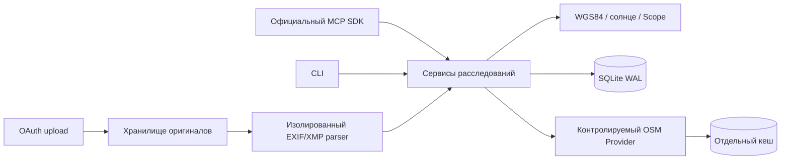

# GeoOSINT

Сервер доказательных географических расследований для MCP-клиентов и локального CLI.
Python 3.12+, CPU, SQLite, один Docker-контейнер. Собственный код — MIT.
Обязательных API облачных моделей, GPU и платных картографических сервисов нет.

**Состояние: работающая основа P0, не полностью завершённый геолокационный продукт.**
Исследовательский слой: [архитектура](docs/investigation-architecture.md).
Подключение и ограничения: [развёртывание](docs/deployment.md).
OAuth и работа с оригинальными файлами реализованы и проверяются локально.
Независимый верификатор соответствия фотографии конкретной сцене ещё отсутствует:
`geo_case_finalize` допускает UNRESOLVED и явно предварительные HYPOTHESIS/PRELIMINARY/
FACT_SUPPORTED с кандидатами; RESOLVED/LOCATION_VERIFIED не устанавливаются.
GPS из файла возвращается немедленно
как `METADATA_LOCATION`, без ложного `LOCATION_VERIFIED`.
Подключение через настоящий интерфейс ChatGPT и публичный HTTPS ещё не проверено.

## Реализовано

- Расследования, владельцы, кандидаты, наблюдения, доказательства, реальные операции,
  оптимистические ревизии, идемпотентность, хеш-цепочка журнала, JSON/Markdown-экспорт.
- WGS84: расстояния, прямые/обратные азимуты, прямые задачи, ограниченные пересечения
  направлений, угловые расстояния и консервативные bounding box.
- Положение солнца и теней по явно заданному времени с UTC offset.
- OSM Overpass: десять разрешённых категорий, небольшой bbox, пагинация, лимиты,
  кеш, TTL, объединение одинаковых запросов, обработка отказов и SSRF-защита.
- Geographic Search Scope: `AUTO`, `PREFERRED`, `STRICT`, полигоны, окружности,
  включения/исключения, административный реестр, бюджеты и журнал расширений.
- Metadata First: JPEG, PNG, WebP, TIFF; EXIF GPS и ограниченный XMP, формальная
  валидация, конфликты, происхождение значений, изолированный серверный парсер.
- OAuth Authorization Code + PKCE S256 на официальном MCP SDK, DCR confidential
  clients, согласие оператора, Argon2id, короткие токены, ротация/отзыв.
- Настоящий Streamable HTTP `/mcp`, CLI, миграции, Docker, health/readiness, тесты и CI.
- GeoPrior средствами облачной модели клиента, универсальный Skill, SceneGraph,
  предложения исследовательских проверок, связанные гипотезы и экспорт графа происхождения.

Не реализованы: HEIC/HEIF, локальное распознавание изображений, DEM, skyline matching,
автоматический поиск сцены по всему миру и проверенная точная геолокация.

## Быстрый локальный запуск

```bash
uv sync --frozen
uv run geoosint --json doctor
uv run geoosint serve
```

По умолчанию сервер слушает `127.0.0.1:8787`, без авторизации **только на loopback**.
Произвольные Bearer-токены в этом режиме отклоняются. `.env.example` — образец:
приложение читает переменные процесса, а не загружает `.env` автоматически.

Проверка файла без сервера, сети и создания расследования:

```bash
uv run geoosint metadata inspect /path/to/original.jpg --json --no-store
```

Сохранение оригинала в существующее локальное дело:

```bash
uv run geoosint --json case-create "Исследование фотографии"
uv run geoosint metadata inspect /path/to/original.jpg --case-id CASE_ID --json
```

## Docker

```bash
docker compose config
docker compose build
docker compose up -d --wait
docker compose exec -T geoosint geoosint --json doctor
docker compose exec -T geoosint python - < scripts/container_smoke.py
docker compose exec -T geoosint python - < scripts/oauth_container_smoke.py
```

На PowerShell вместо перенаправления stdin:

```powershell
Get-Content scripts/container_smoke.py -Raw | docker compose exec -T geoosint python -
```

Основной Compose — изолированный локальный стенд `network_mode: none`, без открытых
портов. Для OAuth-развёртывания подготовлен отдельный override с публикацией только
`127.0.0.1:${GEO_PUBLISHED_PORT:-18787}`. Он требует настройки домена, TLS, hash пароля
и точных callback URI; см. [развёртывание](docs/deployment.md).
Существующие reverse proxy и контейнеры приложение не изменяет.

## Архитектура



Клиентская модель анализирует видимые признаки. Сервер хранит недоверенные наблюдения,
проверяет входы, выполняет математику и контролирует поиск. Выполненный вызов, корректные
метаданные и доказанная локализация — разные утверждения.

## Документация

- [Архитектура и границы готовности](docs/architecture.md)
- [MCP и прикладные контракты](docs/contracts.md)
- [OAuth, угрозы и приватность](docs/security.md)
- [Docker, backup, восстановление и подключение клиентов](docs/deployment.md)
- [Search Scope и географические источники](docs/search-scope.md)
- [Оригиналы, EXIF/XMP и загрузка](docs/metadata.md)
- [Официальные источники и выбранные решения](docs/research.md)
- [Навык агента](skills/geoosint/SKILL.md)

## Проверки

```bash
uv run pytest -q
uv run ruff check src tests scripts
uv run ruff format --check src tests scripts
uv run mypy
uv export --frozen --no-dev --no-emit-project -o requirements-audit.txt
uv run pip-audit -r requirements-audit.txt --no-deps --disable-pip
```

Обычные тесты не обращаются к интернету. Фикстуры географии и изображений явно
синтетические и не выдаются за результаты настоящего расследования. Внешний OSM
включается только оператором с идентифицирующим User-Agent и контактом.
