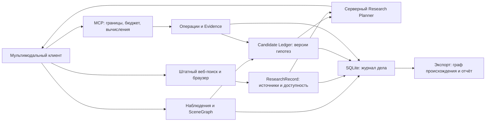

# Архитектура Deep Investigation

Изменение от 20 октября 2026: исследовательский слой расширяет существующее дело.
Локальных моделей, обязательного AI API и отдельной графовой базы нет.

`core/investigation.py` задаёт ограниченные модели SceneGraph, ResearchAction и
ActionOutcome, проекции графа/карточек гипотез и эвристику приоритета. Области кадра
нормализованы, ссылки проверяются, циклы зависимостей запрещены. Таксономия свободная.

`cases/service.py` проверяет владельца дела и артефакта, ревизию, ссылки кандидатов,
наблюдений и операций; сохраняет всё через прежнюю транзакционную mutate/idempotency.
geo_case_next рекомендует доступные проверки, geo_case_export строит граф из журнала.
История ранжирования и parent_id обеспечивают возврат и разделение гипотез.

SQL-схема этого изменения не меняется: новые поля вложены в существующий JSON-документ
дела. Старые документы читаются с пустыми коллекциями по умолчанию. Актуальная версия
SQLite — 4 (предыдущая миграция 004_request_traces.sql). Новых миграций для SceneGraph
не требуется. Существующие 22 MCP-инструмента сохранены, новых имён не добавлено.

Оценки planner поступают от клиента, поэтому не являются объективной мерой информации.
Формула: 3×discrimination + 2×expected_information + reliability + independence
− 2×uninformative_risk − requests − seconds/60. Сначала исключаются недоступные,
слишком дорогие и нарушающие scope действия. Балл не изменяет доказательственную
уверенность кандидата. План не выполняется автоматически и не является разрешением
обходить проверки конкретного инструмента. Даже если агент занизил стоимость,
каждая реальная попытка провайдера проверяет и списывает серверный бюджет.

Ограничения: сервер не видит работу чужого браузера и не может проверить истинность
клиентской capability matrix или утверждения о просмотре изображения. Он обозначает
их CLIENT_REPORTED. Завершённая MCP-проверка требует существующего operation_id,
но смысловая связь вопроса и операции остаётся предметом проверки агента. Источники
хранят dependency_group; автоматического установления общего первоисточника нет.
Статус LOCATION_VERIFIED/RESOLVED эти механизмы не присваивают.
